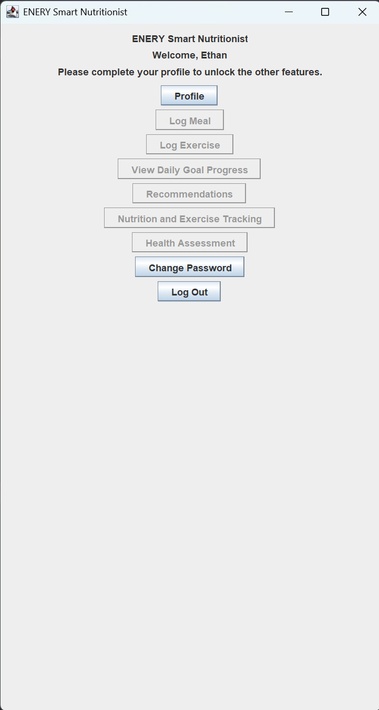
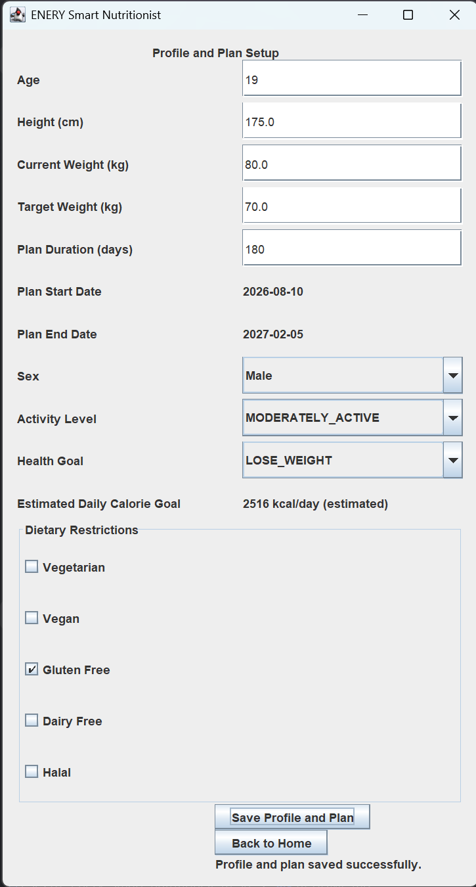
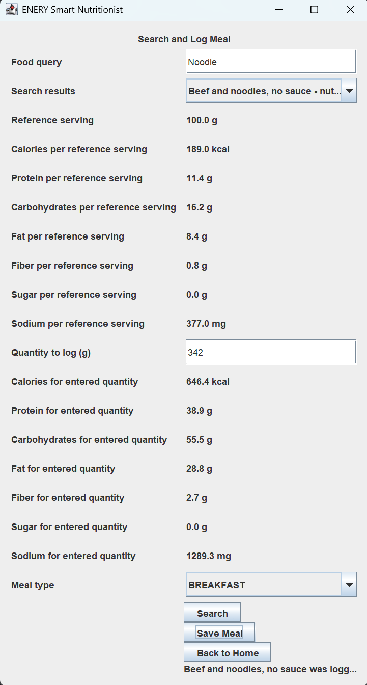
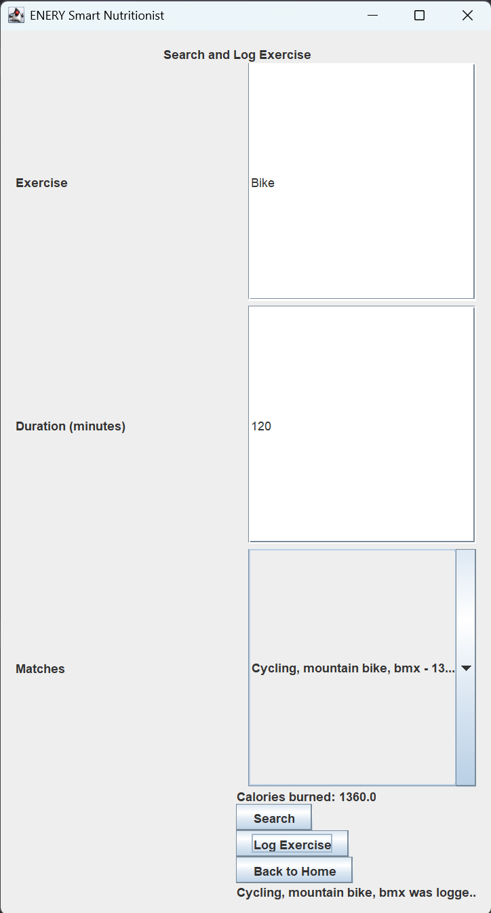
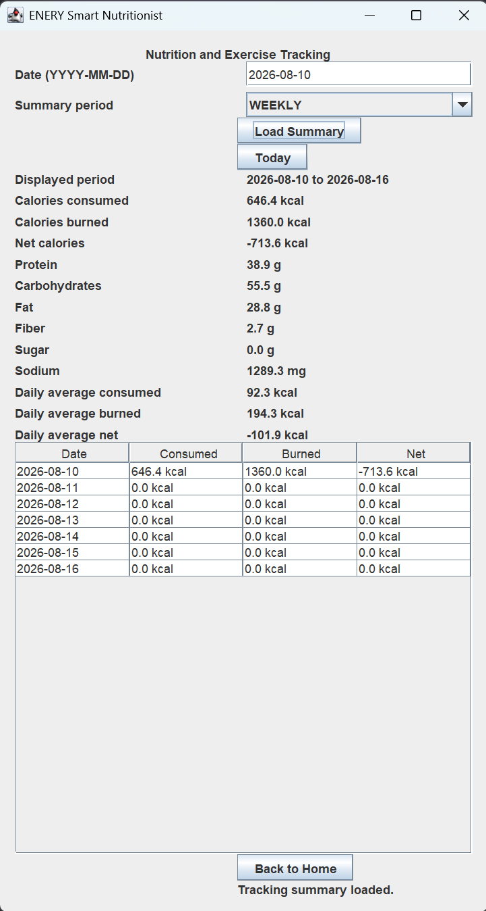
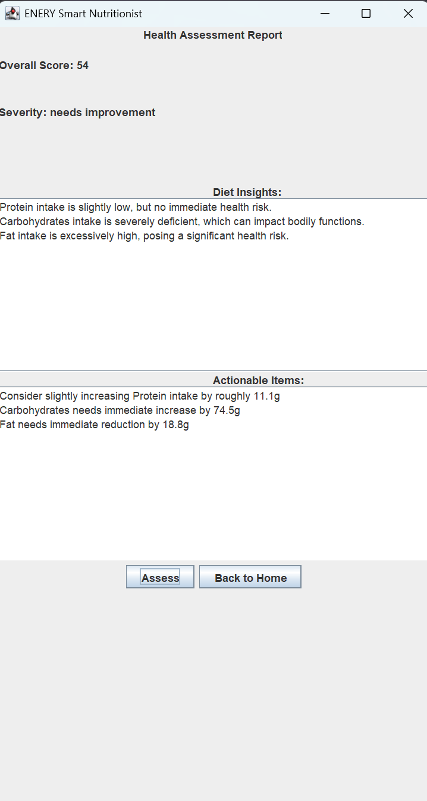
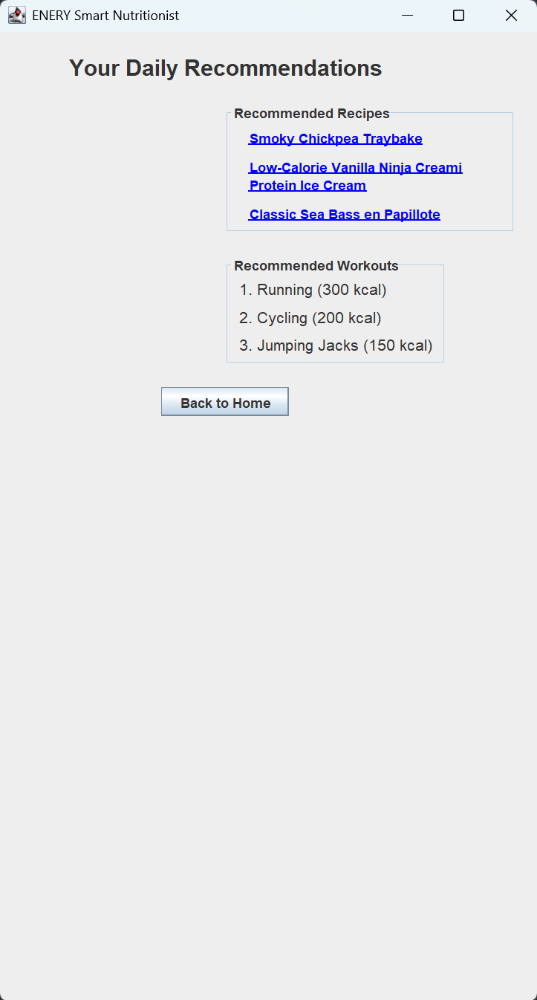

# ENERY Smart Nutritionist

ENERY Smart Nutritionist is a Java Swing desktop application.

The application helps users manage nutrition, exercise, personal goals,
meal logging, recommendations, and progress through a collection of
interconnected use cases implemented using Clean Architecture.

## Table of Contents

-   [Features](#features)
-   [Application Workflow](#application-workflow)
-   [Installation](#installation)
-   [Configuration](#configuration)
-   [Running the Application](#running-the-application)
-   [Usage](#usage)
-   [Architecture](#architecture)
-   [Team Development](#team-development)
-   [Testing and Code Coverage](#testing-and-code-coverage)
-   [Accessibility](#accessibility)
-   [Feedback](#feedback)
-   [Contributing](#contributing)
-   [License](#license)
-   [Authors and Contributors](#authors-and-contributors)

## Features

### User Profile

Users can maintain personal information used by other ENERY features.

Profile information is used to establish health and nutrition goals and
can include information such as physical characteristics, goals, and
dietary restrictions.

### Meal and Exercise Tracking

Users can record meals and exercise activities.

The tracking system records information used to calculate nutritional
intake and exercise-related values. Logged information can then be
reused by other parts of the application, including progress tracking.

### Recommendations

ENERY provides meal and exercise recommendations based on information
available about the user.

Meal recommendations can consider nutritional requirements and dietary
restrictions, while exercise recommendations can consider the type,
level, or amount of exercise appropriate to the user's needs.

### Progress Tracking

The Progress feature displays information about the user's progress
toward daily and longer-term goals.

Tracked calorie and nutrient information can be compared with the user's
goals, allowing the application to indicate whether goals have been
achieved.

### Search

Users can search for recipes and exercises.

Search functionality provides information that can be used by other
features, including recommendations and logging.

### Health Assessment

The Health Assessment feature evaluates aspects of the user's eating and
exercise patterns and provides an additional way for users to understand
their habits.

## Application Workflow

The ENERY features are designed to work together rather than operate as
completely independent tools.

A typical workflow is:

1.  Create an account or log in.
2.  Complete the user profile and establish personal goals.
3.  Search for and log meals or exercise activities.
4.  Use the available profile and tracking information to receive
    recommendations.
5.  Review progress toward daily and longer-term goals.
6.  Use Health Assessment to review eating and exercise patterns.
7.  Continue updating profile and tracking information as needs change.

## Application Screenshots

### Home

The home screen provides access to the major features of ENERY Smart
Nutritionist after the user has completed their profile.



### Profile and Nutrition Plan

Users can enter their age, height, current and target weight, activity
level, health goal, and dietary restrictions. The application uses this
information to estimate a daily calorie goal.



### Meal Logging

Users can search for foods, view nutritional information, specify a
quantity and meal type, and record the meal in their daily nutrition
history.



### Exercise Logging

Users can search for exercises, enter the exercise duration, select a
matching activity, and record the estimated calories burned.



### Nutrition and Exercise Tracking

The tracking screen summarizes calories consumed, calories burned,
net calories, macronutrients, and other nutritional information over
a selected period.



### Health Assessment

The health assessment evaluates the user's recorded nutrition data
and provides a score, diet insights, and actionable suggestions.



### Personalized Recommendations

ENERY provides recipe and workout recommendations based on the user's
profile and nutrition goals.



## Installation

### Requirements

Before running ENERY, make sure the following software is installed:

-   Java Development Kit (JDK) 17
-   Maven
-   Git, if cloning the project from GitHub
-   A desktop environment capable of running Java Swing

### Clone the Repository

Clone the team's repository and enter the project directory:

``` shell
git clone <YOUR-GITHUB-REPOSITORY-URL>
cd csc207-enery-smart-nutritionist
```

Replace `<YOUR-GITHUB-REPOSITORY-URL>` with the URL of the team's
repository.

### Build the Project

From the project root, run:

``` shell
mvn clean test
```

This compiles the project and runs the automated test suite.

### Common Setup Problems

-   If compilation reports an unsupported Java version, verify that the
    project is using JDK 17.
-   If Maven cannot be found, install Maven or run Maven through an IDE
    configuration that provides it.
-   If an external-data feature reports that an API key is unavailable,
    configure the required environment variables described below.
-   Internet access may be required for features that retrieve
    information from external APIs.

## Configuration

Some ENERY features use external APIs. The application expects the
relevant API credentials to be supplied through environment variables
rather than hard-coded into the source code.

The project uses the following environment-variable names:

``` text
API_NINJAS_KEY
USDA_API_KEY
```

Configure the keys in your operating system or in the run configuration
of your IDE before using features that depend on those services.

Do not commit private API keys to the repository.

## Running the Application

After dependencies and API keys have been configured, run the
application's main entry point from the IDE.

If using IntelliJ IDEA:

1.  Open the repository as a Maven project.
2.  Confirm that the Project SDK is JDK 17.
3.  Configure the required API-key environment variables in the
    application's Run Configuration.
4.  Run the application's main class.
5.  The ENERY Java Swing interface should open.

## Usage

### Account and Profile

Start by creating an account or logging in. Complete the profile so that
ENERY has the personal information, goals, and dietary restrictions
required by connected features.

### Meals and Exercise

Use the search and logging features to find and record meals and
exercise activities. Logged information contributes to the data used by
progress and recommendation features.

### Recommendations

Open the recommendation features after profile and tracking information
is available. ENERY can use this information when producing meal and
exercise recommendations.

### Progress

Use Progress to review tracked information against the user's goals.

### Health Assessment

Use Health Assessment to review aspects of eating and exercise patterns
and receive additional feedback based on information available to the
application.

## Architecture

ENERY follows the Clean Architecture principles taught in CSC207.

The application is separated into layers including:

-   Entities
-   Use Cases
-   Interface Adapters
-   Data Access
-   Views
-   Application wiring

A typical use-case flow is:

``` text
View
  ↓
Controller
  ↓
Input Boundary
  ↓
Interactor
  ↓
Data Access Interface / Entities
  ↓
Output Boundary
  ↓
Presenter
  ↓
View Model
  ↓
Updated View
```

This structure follows the Dependency Rule: inner application layers do
not depend directly on Swing views or concrete external data sources.

The architecture also supports SOLID principles by separating
responsibilities and allowing use-case logic to depend on interfaces
rather than concrete UI or data-access implementations.

## Team Development

ENERY was developed as a team project with major functionality divided
among team members.

The original feature division included:

-   User Profile
-   Tracking and Logging
-   Recommendations
-   Progress
-   Search and Home functionality
-   Health Assessment

Although these features were divided among team members, they were
designed to interact through shared application architecture.

For example, profile information can influence recommendations and
goals; logging produces information used by progress tracking; and
search functionality provides recipes and exercises that can be used by
other use cases.

The team therefore worked not only on individual features but also on
integrating shared entities, data access, navigation, and application
wiring.

## Testing and Code Coverage

The project includes automated tests for entities, use cases, interface
adapters, data-access functionality, and Swing views. The tests cover
successful and unsuccessful use-case paths, validation, state changes,
controller and presenter interactions, data-access behavior, and
user-interface behavior where practical.

Run the complete Maven test suite with:

``` shell
mvn clean test
```

The latest full-project IntelliJ IDEA coverage run produced
approximately **85% overall line coverage**. The `use_case` package
achieved approximately **96% line coverage**.

For detailed coverage results and explanations of intentionally
uncovered code, see [COVERAGE.md](COVERAGE.md).

## Accessibility

Accessibility and Universal Design considerations are documented
separately. The report discusses the seven Principles of Universal
Design, target users, demographic and ethical considerations, current
limitations, and possible future accessibility improvements.

See [accessibility-report.md](accessibility-report.md).

## Feedback

Users can provide feedback through the GitHub repository's Issues
section.

Useful feedback should clearly describe the problem or suggestion and,
for bugs, should include relevant reproduction steps, expected behavior,
actual behavior, and any useful error messages. Feature suggestions
should explain the proposed behavior and why it would improve the
application.

The development team can review submitted issues and determine whether
they should be investigated, clarified, or considered for a future
change.

## Contributing

Contributions should follow the team's Git/GitHub workflow:

1.  Create a branch for the change.
2.  Make focused changes related to the assigned feature or issue.
3.  Add or update tests where appropriate.
4.  Run `mvn clean test` before submitting the change.
5.  Commit changes with a descriptive commit message.
6.  Push the branch to GitHub.
7.  Open a pull request into the team's integration/default branch.
8.  Have the change reviewed by team members.
9.  Resolve relevant review comments and merge after the change is
    ready.

Contributors should avoid committing API keys, generated build output,
IDE-specific temporary files, or unrelated changes.

## License

This project is licensed under the MIT License. See the
[LICENSE](LICENSE) file for details.
selected by the team and place the corresponding license text in a
`LICENSE` file in the repository. The license stated here should match
that file.

## Authors and Contributors

**Team action required before final submission:** replace this note with
the full names of all ENERY team members.

-   \[Team member 1\]
-   \[Team member 2\]
-   \[Team member 3\]
-   \[Team member 4\]
-   \[Team member 5\]
-   \[Team member 6\]
